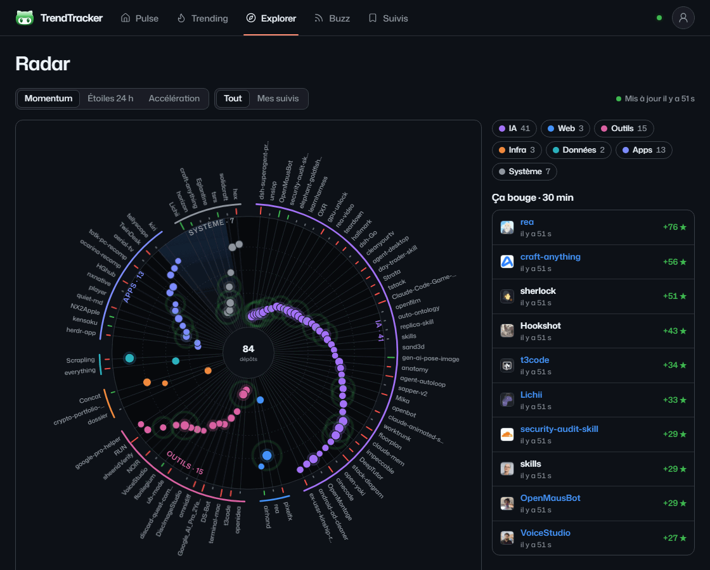

<p align="center">
  
</p>

<h1 align="center">TrendTracker</h1>

<p align="center">
  <b>Le radar en temps réel des dépôts GitHub qui montent.</b><br />
  <a href="https://jaggerthestone.github.io/TrendTracker/"><b>Site</b></a> · <a href="README.md">English</a> · Français
</p>

<p align="center">
  
</p>

Le radar des dépôts GitHub qui montent. Tu entends parler d'un projet dans une vidéo ou un post : colle le lien,
tu vois d'où il vient, à quelle vitesse il grimpe et qui en parle. Et tu peux suivre ceux qui t'intéressent.

## Démarrer

```bash
npm install
cp .env.example .env.local   # facultatif
npm run dev
```

Ouvre http://localhost:3000. Sans `DATABASE_URL`, une base Postgres embarquée (PGlite) est créée dans `.data/pglite`.
La première collecte démarre deux secondes après le lancement, puis toutes les 5 minutes.

Un `GITHUB_TOKEN` (jeton classic sans aucune case cochée, https://github.com/settings/tokens/new) est fortement
conseillé : 5 000 appels/heure au lieu de 60, et les étoiles de tous les dépôts affichés sont relues **chaque minute**
(API GraphQL, quelques points par minute). Les pages reçoivent les nouveaux chiffres en direct (Server-Sent Events) :
les compteurs s'animent, le radar ondule quand un dépôt prend une étoile. L'historique des étoiles se construit à partir
de nos propres relevés, GitHub ne publiant plus la liste des stargazers.

## Écrans

| Page                       | Contenu                                                                                                                                                                                                 |
| -------------------------- | ------------------------------------------------------------------------------------------------------------------------------------------------------------------------------------------------------- |
| **Pulse** (`/`)            | Chiffres du jour, dépôts du moment, brief, Trending du jour, vidéos, développeurs et sujets en vue                                                                                                      |
| **Trending** (`/trending`) | GitHub Trending du jour, de la semaine, du mois, par langage, et l'archive des jours passés                                                                                                             |
| **Explorer** (`/explorer`) | Recherche (nom, sujet, lien collé), classement par momentum, filtres ; accès Sujets, Développeurs, Radar, Comparer                                                                                      |
| **Sujets** (`/sujets`)     | Sujets GitHub classés par étoiles gagnées ; page par sujet : en vue, les plus étoilés, sujets liés                                                                                                      |
| **Développeurs** (`/dev`)  | Comptes en vue ; page profil : dépôts en vue, populaires, jours dans le Trending                                                                                                                        |
| **Radar** (`/radar`)       | Un rayon par dépôt, secteurs par domaine, centre = les plus forts (momentum, étoiles 24 h ou accélération), repères verts/rouges d'accélération, ondes à chaque étoile reçue, fil « Ça bouge · 30 min » |
| **Comparer** (`/comparer`) | Jusqu'à 4 dépôts : courbes d'étoiles (par date ou depuis la création) et tableau de chiffres                                                                                                            |
| **Buzz** (`/buzz`)         | Vidéos YouTube, Hacker News, Lobsters et Mastodon qui citent un dépôt                                                                                                                                   |
| **Suivis** (`/suivis`)     | Tableaux, notes, partage public, activité ; alertes e-mail (menu du compte)                                                                                                                             |

Fiche dépôt (`/r/<owner>/<name>`), mise à jour en direct : étoiles, gains 24 h et 7 j, momentum, badges datés (N°1 du
Trending le…, jours d'affilée…), étoiles, forks et PR fusionnées par jour (de minuit à minuit UTC, journée en cours
signalée), classement Trending sur 30 jours, historique des étoiles (48 h / 7 j / 30 j / tout), commits, langages,
versions, mentions, dépôts similaires, badge à coller dans un README, README, analyse IA (si `ANTHROPIC_API_KEY`).

**Alertes e-mail** (menu du compte) : un dépôt suivi entre dans le Trending, prend une forte poussée d'étoiles, ou
résumé de la semaine. Envoyées après chaque collecte, une seule fois par dépôt et par jour.

## Connexion

- **E-mail** : code à 6 chiffres envoyé à l'adresse saisie. Renseigne un serveur SMTP dans `.env.local`
  (`SMTP_HOST`, `SMTP_PORT`, `SMTP_USER`, `SMTP_PASSWORD`). Avec Gmail : active la validation en deux étapes, crée un
  [mot de passe d'application](https://myaccount.google.com/apppasswords), puis `SMTP_HOST=smtp.gmail.com`,
  `SMTP_PORT=465`. Resend (`RESEND_API_KEY`) marche aussi. Sans rien, le code s'affiche dans le terminal (dev).
- **Google** en fenêtre pop-up : `GOOGLE_CLIENT_ID` et `GOOGLE_CLIENT_SECRET` (URI de redirection
  `/api/auth/callback/google`).

Les réglages (thème clair/sombre/auto, période par défaut) sont dans le menu du compte, en haut à droite.

## Sources (sans compte)

| Source             | Ce qu'on en tire                                                        |
| ------------------ | ----------------------------------------------------------------------- |
| GitHub Trending    | Étoiles gagnées aujourd'hui, cette semaine, ce mois (tous langages + 7) |
| API GitHub Search  | Nouveaux dépôts qui décollent, métadonnées (sujets, licence, langage)   |
| YouTube            | Dépôts liés dans les descriptions de 20 chaînes dev (flux RSS publics)  |
| Hacker News        | Stories de la semaine qui pointent vers un dépôt                        |
| Lobsters, Mastodon | Liens GitHub partagés                                                   |

Instagram, TikTok, X et Reddit n'ont pas d'accès anonyme utilisable : ils ne sont pas simulés.

## Calcul

- **Gain (24 h, 7 j, 30 j)** : compteur actuel moins le compteur au début de la fenêtre, lu entre les deux relevés qui
  l'encadrent. Un dépôt créé dans la fenêtre a gagné toutes ses étoiles. Sinon, le chiffre de GitHub Trending, puis une
  extrapolation si nous avons observé au moins la moitié de la fenêtre ; sinon « — ». Toujours 24 h ≤ 7 j ≤ 30 j ≤ total.
- **Accélération** : gain des dernières 24 h divisé par la moyenne des jours précédents (ou par les 24 h d'avant).
- **Momentum (0–100)** : vitesse (60 %, percentile parmi tous les dépôts actifs), croissance relative (15 %),
  accélération (10 %) et buzz pondéré par source (15 %). Un dépôt hors classement est noté contre le même ensemble.
- **Statut** : en feu (5 % les plus rapides, ≥ 100 ★/j), accélère (≥ ×1,4 et ≥ 20 ★/j), ralentit (≤ ×0,6), nouveau
  (créé il y a moins de 7 jours), sinon stable.
- **Relevés** : un relevé au plus toutes les 4 minutes par dépôt ; au-delà de 6 h, un par demi-heure, puis un toutes
  les 4 h après 3 jours et un par jour après un mois (conservés 400 jours).

## Architecture

```
src/
  app/                  écrans (/, /explorer, /radar, /buzz, /suivis, /r/[owner]/[name], /b/[shareId]) et API
    api/auth            Better Auth (Google pop-up, code e-mail)
    api/overview        dépôts classés + mentions + état des sources
    api/stream          Server-Sent Events à chaque collecte
    api/search          recherche GitHub ou ouverture d'un lien
    api/boards, api/me  tableaux de l'utilisateur
    api/analyze         analyse IA d'un dépôt (facultative)
  components/           vues, micro-graphiques, radar
  server/
    sources/            un collecteur par source
    github/api.ts       client GitHub (quotas, README, versions, historique)
    ingest.ts           collecte, enrichissement (GraphQL), compactage des relevés
    live.ts             étoiles des dépôts affichés, chaque minute
    overview.ts         gains, momentum, statut
    repo-detail.ts      fiche dépôt (cache 6 h)
    db/                 schéma Drizzle, PGlite ou Postgres
drizzle/                migrations SQL
```

## Déployer

1. Postgres (Neon, Supabase) → `DATABASE_URL`, puis `npm run db:migrate`.
2. Variables : `BETTER_AUTH_SECRET`, `BETTER_AUTH_URL`, `CRON_SECRET`, `GITHUB_TOKEN`, et selon les besoins Google,
   Resend, Anthropic.
3. Collecte : `.github/workflows/ingest.yml` appelle `/api/ingest` toutes les 5 minutes (variable `APP_URL`, secret
   `CRON_SECRET`). Sur un serveur classique (`next start`), le planificateur intégré suffit et relit aussi les étoiles
   chaque minute ; en serverless, un cron d'une minute peut appeler `/api/ingest?live`.

## Scripts

| Commande                                | Rôle                                       |
| --------------------------------------- | ------------------------------------------ |
| `npm run dev`                           | serveur de dev + collecte automatique      |
| `npm run build`                         | build de production                        |
| `npm run db:generate`                   | migration après modification du schéma     |
| `npm run db:migrate`                    | applique les migrations sur `DATABASE_URL` |
| `npm run ingest`                        | collecte ponctuelle (Postgres)             |
| `npm run lint` / `typecheck` / `format` | qualité                                    |

L'ancienne version Express est conservée dans l'historique git, sous le tag `legacy-v1`.

## Contribuer

Les contributions sont bienvenues : lis [CONTRIBUTING.md](CONTRIBUTING.md). Pour une faille de sécurité, voir
[SECURITY.md](SECURITY.md).

## Licence

[MIT](LICENSE).

## Crédits

Logo dérivé de l'icône « github-alt » de [Font Awesome Free](https://fontawesome.com) (licence [CC BY 4.0](https://fontawesome.com/license/free)), redessiné en relief avec dégradés.
