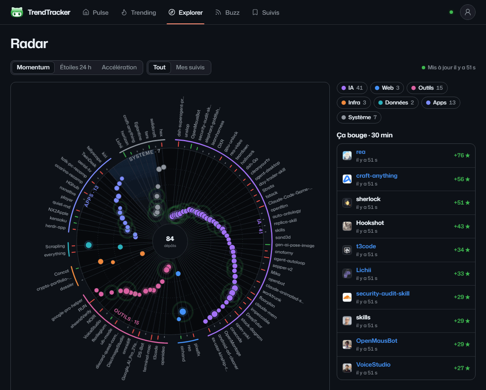
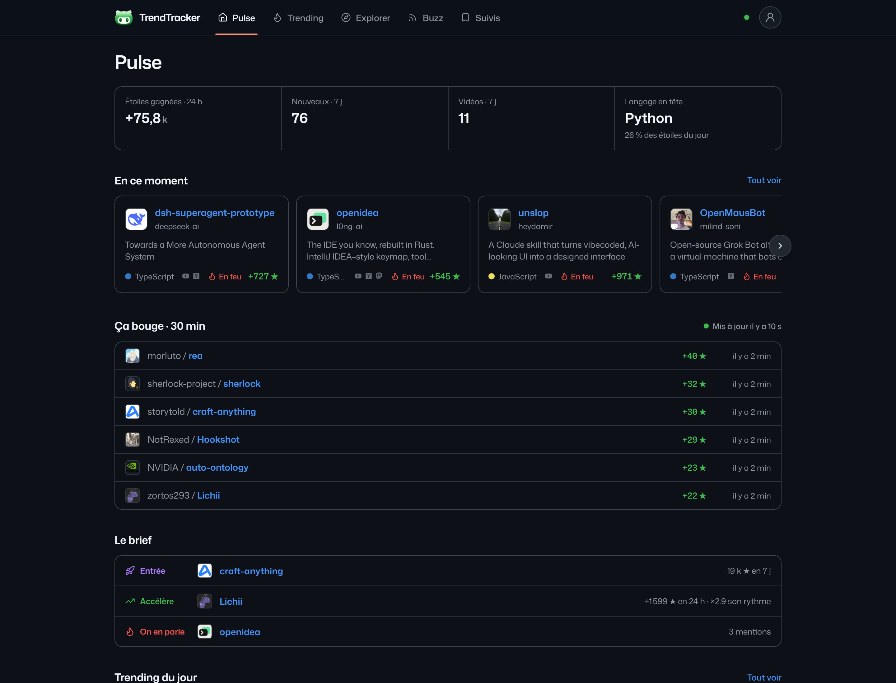
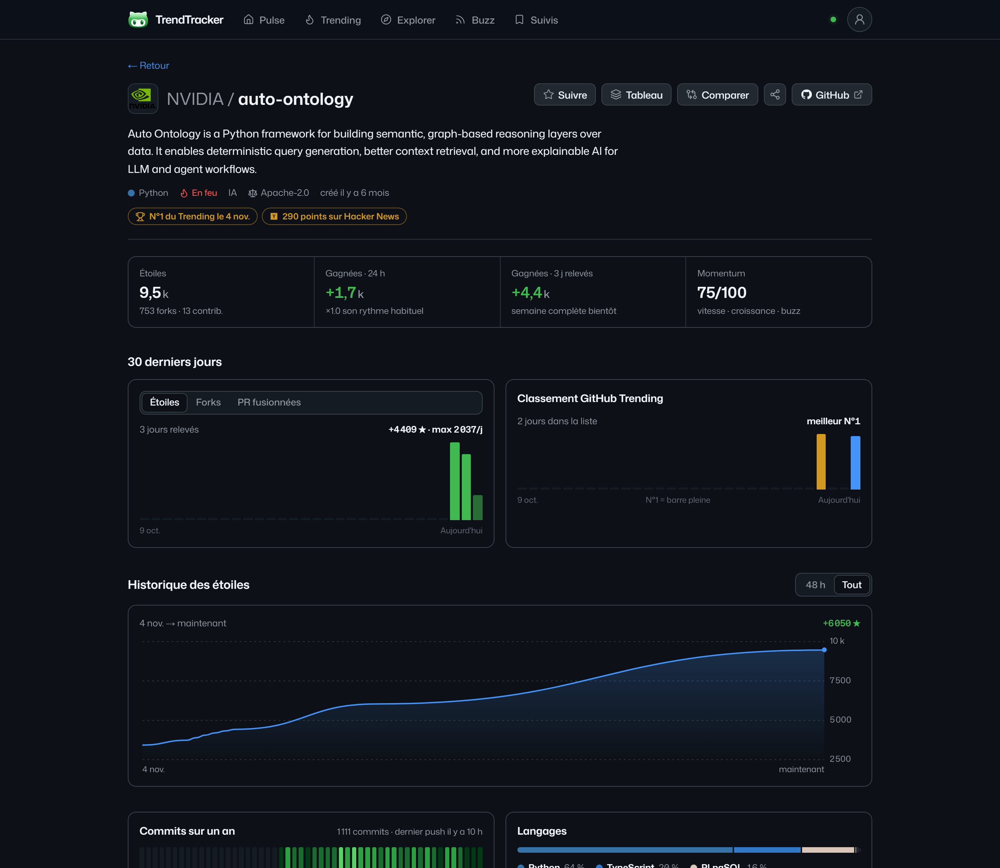
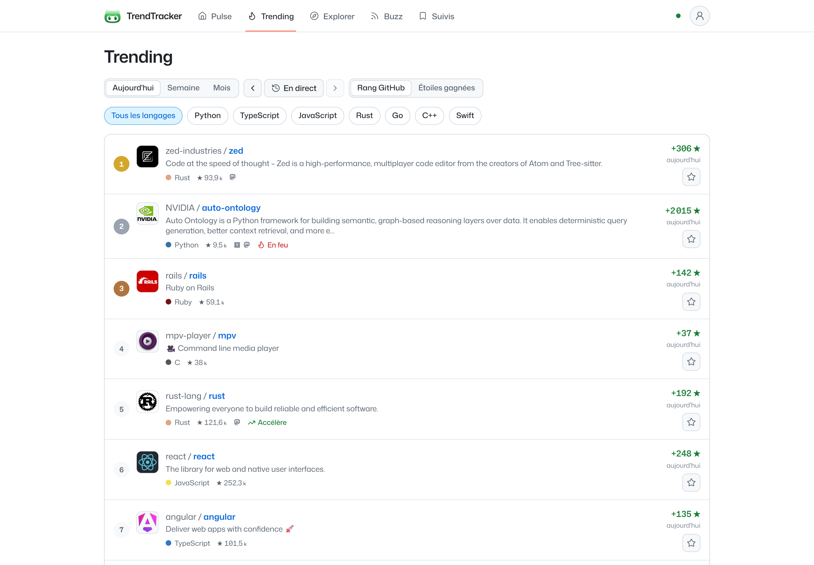
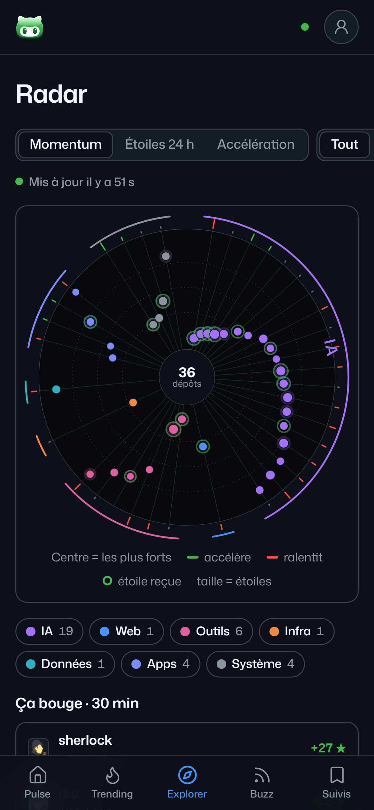
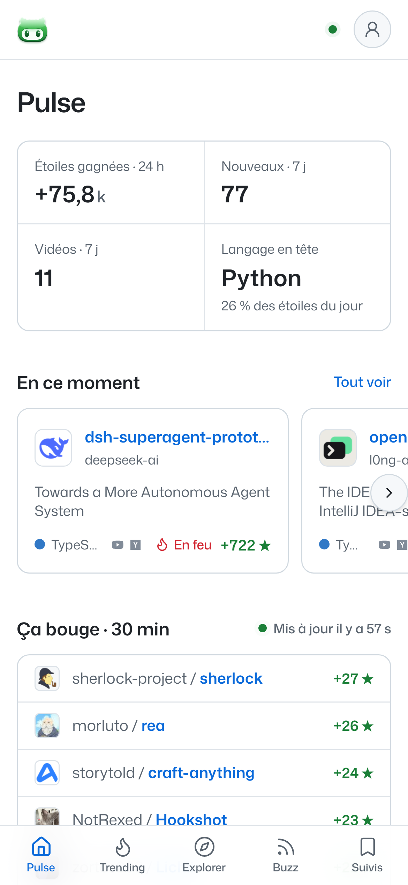

<p align="center">
  
</p>

<h1 align="center">TrendTracker</h1>

<p align="center">
  <b>A real-time radar of the GitHub repositories that are taking off.</b><br />
  Live star counts every minute · momentum scores · trend radar · buzz from YouTube and Hacker News
</p>

<p align="center">
  <a href="https://github.com/jaggerTheStone/TrendTracker/actions/workflows/ci.yml"></a>
  <a href="LICENSE"></a>
  
  
  
  
</p>

<p align="center">
  <a href="https://jaggerthestone.github.io/TrendTracker/"><b>Website</b></a> · English · <a href="README.fr.md">Français</a>
</p>

<p align="center">
  
</p>

You hear about a project in a video or a post. Paste the link and TrendTracker shows where it comes from, how fast it is
climbing right now, and who is talking about it. Or open the radar and see what the whole of GitHub is getting excited
about, as it happens.

## Why

GitHub Trending gives you a list, refreshed a few times a day, with no history and no context. TrendTracker watches
those repositories (and the new ones the list misses) **minute by minute**, keeps its own history, and tells you which
projects are genuinely accelerating, not just big.

- **Live.** With a GitHub token, the star count of every repository on screen is re-read every minute and pushed to the
  page over Server-Sent Events. Counters tick up, the radar ripples when a project gets new stars.
- **Honest numbers.** Gains over 24 h, 7 days and 30 days come from our own snapshots, read between the two snapshots
  around the start of each window. They always add up (24 h ≤ 7 d ≤ 30 d ≤ total), and when we have not watched long
  enough the app says so instead of guessing.
- **Context.** Every repository links back to the YouTube videos, Hacker News stories, Lobsters, Mastodon and Bluesky
  posts that mention it.
- **No fake data.** Only public, anonymous sources. Platforms without usable public access (X, Instagram, TikTok,
  Reddit) are not simulated.

## Features

|                         |                                                                                                                                                                                                       |
| ----------------------- | ----------------------------------------------------------------------------------------------------------------------------------------------------------------------------------------------------- |
| **Radar**               | One spoke per repository, sectors by domain (AI, web, tools, infra…), strongest in the centre. Rank by momentum, stars in 24 h or acceleration. Green and red ticks show who speeds up or slows down. |
| **Pulse**               | The day at a glance: stars gained, newcomers, what moves in the last 30 minutes, a three-line brief, today's Trending.                                                                                |
| **Trending archive**    | GitHub Trending (day, week, month, by language), archived every day, sortable by GitHub rank or by stars gained.                                                                                      |
| **Repository page**     | Live stars, gains, momentum, dated badges (#1 on Trending, days in a row…), stars / forks / merged PRs per day, star history, commits, languages, releases, mentions, similar projects.               |
| **Explorer**            | Search by name or topic, or paste any GitHub link. Filters by domain and language.                                                                                                                    |
| **Topics & developers** | Topics and accounts ranked by the stars their repositories gain today.                                                                                                                                |
| **Compare**             | Up to four repositories side by side, star curves by date or since creation.                                                                                                                          |
| **Buzz**                | YouTube videos (20 developer channels), Hacker News, Lobsters, Mastodon and Bluesky posts that link to a repository.                                                                                  |
| **Boards & alerts**     | Follow repositories in boards, add notes, share a board publicly, get e-mail alerts when one enters Trending or spikes.                                                                               |
| **README badge**        | A live badge (`#1 on Trending`, `+2.1k ★ this week`) maintainers can paste into their README.                                                                                                         |
| **AI analyst**          | Optional: what the project is, why it is rising, who it is for (Claude, with `ANTHROPIC_API_KEY`).                                                                                                    |

> The interface is in French for now. An English version is the first item on the [roadmap](#roadmap).

## Screenshots

<table>
  <tr>
    <td width="50%"></td>
    <td width="50%"></td>
  </tr>
  <tr>
    <td></td>
    <td>
      
      
    </td>
  </tr>
</table>

## Quick start

Requirements: Node.js 20.9 or later. No database to install: without `DATABASE_URL`, an embedded Postgres (PGlite) is
created in `.data/pglite`.

```bash
git clone https://github.com/jaggerTheStone/TrendTracker.git
cd TrendTracker
npm install
cp .env.example .env.local   # optional, see below
npm run dev
```

Open http://localhost:3000. The first collection starts two seconds after launch, then runs every 5 minutes.

**Strongly recommended:** add a `GITHUB_TOKEN` to `.env.local`. A
[classic token with no scope ticked](https://github.com/settings/tokens/new) is enough. It raises the GitHub quota from
60 to 5,000 calls an hour and turns on the one-minute live refresh (a few GraphQL points per minute).

## Configuration

Everything is optional for local use. See [`.env.example`](.env.example) for details.

| Variable                                                                   | What it does                                                                                  |
| -------------------------------------------------------------------------- | --------------------------------------------------------------------------------------------- |
| `GITHUB_TOKEN`                                                             | 5,000 calls/hour and live star counts every minute                                            |
| `DATABASE_URL`                                                             | Any Postgres (Neon, Supabase…). Empty: embedded PGlite                                        |
| `INGEST_INTERVAL_MINUTES` / `LIVE_INTERVAL_SECONDS`                        | Full collection (default 5 min) and live refresh (default 60 s). `0` disables                 |
| `SMTP_HOST`, `SMTP_PORT`, `SMTP_USER`, `SMTP_PASSWORD` or `RESEND_API_KEY` | Sign-in codes and alerts by e-mail. Without them, codes are printed in the console (dev only) |
| `GOOGLE_CLIENT_ID`, `GOOGLE_CLIENT_SECRET`                                 | Google sign-in in a pop-up (redirect URI `/api/auth/callback/google`)                         |
| `ANTHROPIC_API_KEY`                                                        | Enables the AI analyst on repository pages                                                    |
| `BETTER_AUTH_SECRET`, `BETTER_AUTH_URL`, `CRON_SECRET`                     | Required in production                                                                        |

## How the numbers work

- **Gain (24 h, 7 d, 30 d):** current count minus the count at the start of the window, read between the two snapshots
  around it. A repository created inside the window gained all its stars in it. Otherwise GitHub Trending's own figure,
  then an extrapolation if we watched at least half of the window; otherwise "—".
- **Acceleration:** stars in the last 24 h divided by the average of the previous days (or the previous 24 h).
- **Momentum (0–100):** speed (60 %, percentile among all active repositories), relative growth (15 %), acceleration
  (10 %) and buzz weighted by source (15 %). Bluesky buzz counts likes and reposts. A repository outside the ranking is
  scored against the same pool, so a score means the same thing everywhere.
- **Status:** on fire (top 5 % by speed, ≥ 100 ★/day), accelerating (≥ ×1.4 and ≥ 20 ★/day), slowing down (≤ ×0.6),
  new (created less than 7 days ago), otherwise steady.
- **Snapshots:** at most one every 4 minutes per repository; after 6 hours, one per half hour, then one every 4 hours
  after 3 days and one a day after a month, kept for 400 days.

GitHub no longer publishes stargazer lists, so star history starts the day TrendTracker first sees a repository.

## Sources

| Source             | What we take from it                                                    |
| ------------------ | ----------------------------------------------------------------------- |
| GitHub Trending    | Stars gained today, this week, this month (all languages + 7 languages) |
| GitHub API         | New repositories taking off, metadata, live star counts (GraphQL)       |
| YouTube            | Repositories linked in the descriptions of 20 developer channels (RSS)  |
| Hacker News        | Stories of the week pointing to a repository                            |
| Lobsters, Mastodon | GitHub links being shared                                               |
| Bluesky            | Public posts linking to GitHub repositories (no account required)       |

## Architecture

```
src/
  app/                 pages and API routes (App Router)
    api/stream         Server-Sent Events: a fresh overview after every refresh
    api/overview       ranked repositories, mentions, source status
    api/ingest         collection endpoint for external schedulers (?live for counts only)
  components/          views, charts, radar
  server/
    sources/           one collector per source
    github/api.ts      GitHub REST + GraphQL client with per-token quotas
    ingest.ts          full collection, enrichment, snapshot compaction
    live.ts            star counts of everything on screen, every minute
    overview.ts        gains, acceleration, momentum, status
    repo-detail.ts     repository page (cached 6 h)
    db/                Drizzle schema, PGlite or Postgres
drizzle/               SQL migrations
```

Built with Next.js 16 (App Router, Cache Components), React 19, Tailwind CSS 4, Motion, Drizzle ORM, PGlite / Postgres
and Better Auth.

## Deploy

1. A Postgres database (Neon, Supabase…) in `DATABASE_URL`, then `npm run db:migrate`.
2. Set `BETTER_AUTH_SECRET`, `BETTER_AUTH_URL`, `CRON_SECRET`, `GITHUB_TOKEN`, plus Google, SMTP/Resend or Anthropic
   keys as needed.
3. Scheduling: on a long-running server (`npm run build && npm start`), the built-in scheduler collects every 5 minutes
   and refreshes counts every minute. On serverless, `.github/workflows/ingest.yml` calls `/api/ingest` every 5 minutes
   (repository variable `APP_URL`, secret `CRON_SECRET`), and any one-minute cron can call `/api/ingest?live`.

## Scripts

| Command                                 | Purpose                             |
| --------------------------------------- | ----------------------------------- |
| `npm run dev`                           | dev server + automatic collection   |
| `npm run build` / `npm start`           | production build and server         |
| `npm run db:generate`                   | new migration after a schema change |
| `npm run db:migrate`                    | apply migrations to `DATABASE_URL`  |
| `npm run ingest`                        | one-off collection (Postgres)       |
| `npm run lint` / `typecheck` / `format` | quality checks                      |

## Roadmap

- [ ] English interface (i18n), then other languages
- [ ] One-click deploy and a public demo
- [x] Bluesky as a buzz source ([#11](https://github.com/jaggerTheStone/TrendTracker/pull/11))
- [ ] More sources: Product Hunt, dev.to
- [ ] Topic and language radars, weekly digest page
- [ ] Docker image

Ideas and votes are welcome in [issues](https://github.com/jaggerTheStone/TrendTracker/issues).

## Contributing

Contributions are welcome: read [CONTRIBUTING.md](CONTRIBUTING.md) to get started, and please follow the
[code of conduct](CODE_OF_CONDUCT.md). To report a vulnerability, see [SECURITY.md](SECURITY.md).

If TrendTracker is useful to you, a ⭐ helps other people find it.

## License

[MIT](LICENSE) © jaggerTheStone

The logo is derived from the "github-alt" icon of [Font Awesome Free](https://fontawesome.com)
([CC BY 4.0](https://fontawesome.com/license/free)), redrawn in relief with gradients.
